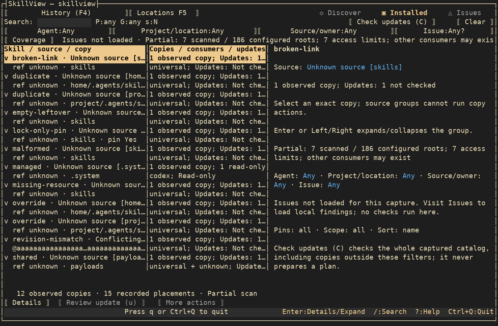

# gh-skillview

`gh-skillview` helps you find, preview, install, update, and safely remove agent skills. Use its full-screen terminal app or scriptable CLI.

[Website](https://skillview.dev/) · [Documentation](https://skillview.dev/docs.html)

[](https://github.com/harder/gh-skillview/actions/workflows/ci.yml)
[](https://github.com/harder/gh-skillview/actions/workflows/release.yml)
[](LICENSE)

This checkout documents the development version. Some workflows below may be ahead of your installed release; check `skillview --version` and `skillview --help`.

## Install

You need [GitHub CLI](https://cli.github.com/) **2.102.0 or newer**. Sign in with `gh auth login` to search and install skills.

### GitHub CLI extension (recommended)

```bash
gh extension install harder/gh-skillview
gh skillview
```

Update later with `gh extension upgrade harder/gh-skillview`.

### Homebrew (macOS Apple Silicon and Linux x64)

```bash
brew install harder/tap/skillview
skillview
```

This installs the standalone app and its `gh` dependency. Run `brew upgrade harder/tap/skillview` for future releases.

### Standalone app

Download the binary for your platform from the [latest release](https://github.com/harder/gh-skillview/releases):

| Platform | Asset |
|---|---|
| Windows x64 | `skillview-windows-amd64.exe` |
| Windows ARM64 | `skillview-windows-arm64.exe` |
| Linux x64 | `skillview-linux-amd64` |
| macOS ARM64 | `skillview-darwin-arm64` |

Put the binary on your `PATH`. On macOS and Linux, make it executable first (`chmod +x <downloaded-file>`). Release binaries are self-contained; no separate .NET runtime is needed.

## Use SkillView

Start with `gh skillview` (extension) or `skillview` (standalone):

1. **Discover (1):** search, preview a skill and press `i` to review its placement before installing.
2. **Installed (2):** inspect an exact physical copy and every recorded consumer. Press `C` to check updates explicitly; `u` prepares that copy's saved update review.
3. **Issues (3):** inspect local problems and review suggestions. Expand a family, select an exact child and compare it. A suggestion never applies a change by itself.
4. Review the exact target, source changes and affected consumers. Source acknowledgement and permission to retain the original are separate approvals. Undo and recovery have their own fresh reviews.

Local browsing does not require a remote authentication check. **F5 / Locations** chooses known scan roots, workspaces and profiles; incomplete coverage stays unknown. **F4 / History** inspects saved replacements and eligible retirement actions. Press **? / F1** for the current screen's keys, **F2** for technical evidence, and **Ctrl+Q** to quit.

Read the [usage guide](docs/usage.md) for keyboard controls and configuration, the [supported actions matrix](docs/supported-actions.md) for what each selection can do, [saved updates](docs/saved-updates.md) for review/apply/Undo, and [quarantine and undo](docs/quarantine-and-undo.md) for standalone relocation. Unmatched gh registry records provide inspection guidance; they are not automatic cleanup targets.

For the full range of discovery and repair options, see [Find, diagnose and fix skills](docs/find-diagnose-fix.md): add workspaces and profiles, inspect coverage and owner conflicts, check package references, compare copies, review updates or recorded restoration, and use purpose-specific local-source, unpin, removal and Move aside workflows. Guided review handles eligible items one at a time; retained-operation History supports fresh Undo/recovery and explicit retirement.



*Current development app with an isolated sample inventory; no remote authentication or repair is implied.*

The CLI offers the same core workflows:

```bash
skillview doctor
skillview search terraform
skillview preview OWNER/REPO SKILL
skillview install OWNER/REPO SKILL
skillview list --json
skillview update --dry-run
skillview cleanup
```

Use `gh skillview` in place of `skillview` when installed as an extension. Run `skillview --help` for commands and options. For the full keyboard reference, CLI flags, exit codes, configuration, and troubleshooting, see the [usage guide](docs/usage.md).

## Contributing

See [CONTRIBUTING.md](CONTRIBUTING.md) for development setup, architecture, tests, and contribution guidance.
For native CI coverage, queued proof jobs and failure diagnosis, see the
[CI guide](agent_docs/ci-runtime-optimization.md).

## Built with

[Terminal.Gui](https://github.com/tui-cs/Terminal.Gui), [GitHub CLI](https://cli.github.com/), and [.NET 10](https://dotnet.microsoft.com/).

## License

MIT. See [LICENSE](LICENSE).
