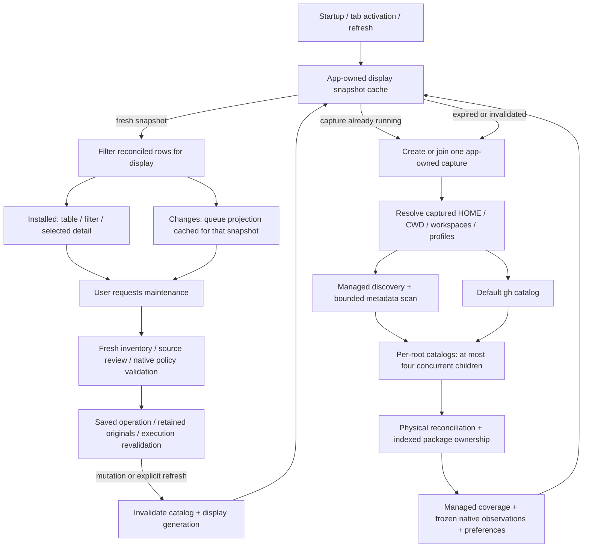

# Inventory and tab performance

This analysis covers startup, Installed, Changes, refresh, and the boundary into
maintenance operations. Measurements were taken on the maintainer's ARM64 Mac
with SDK 10.0.113 / runtime 10.0.13 and the existing local inventory: 168 physical
skill rows, 67 discovered root/context observations, 133 owner records, and 236 Changes observations.
These are observations from this machine, not cross-platform performance guarantees.

## Where the regression came from

The PR history added necessary discovery and ownership semantics without a
corresponding index/cache boundary for ordinary browsing:

- #42 introduced explicit per-root catalog observations. Default discovery alone
  cannot establish absence in a particular root. Keep this coverage information.
- #43/#44 introduced contextual package ownership and payload comparisons. The
  inventory package matcher subsequently compared every installation with every
  owner record, including repeated native path resolution and case probes.
- #45 added namespace/workspace/profile discovery; multiple contextual exposures
  must survive physical deduplication.
- #59 added managed plugin/built-in discovery and ownership regions. Region
  coverage was repeatedly resolved during discovery, scanning, and enrichment.
- #61 added frozen native observations. Measurements show that the final native
  observation stage itself is small; it was not the main cause of the delay.
- #64's cleanup preferences and the on-demand loading, package-check,
  copy-comparison, and saved-update workflows are not all executed at startup.
  Do not attribute the startup cost to all later features indiscriminately.

History establishes when these paths appeared. It is not a benchmark of each old
commit, whose SDK/dependencies/discovery coverage differ. The before/after
comparison here uses the current inventory and current toolchain.

The previous UI change also hid old rows during refresh. That made the existing
full-capture wait more apparent. It did not create the expensive matching loop.

## The full flow

Startup and all three inventory-backed workspaces use the same full-context display
capture. Scope filtering happens on reconciled rows and retains the other
consumers in each row. The display cache belongs to one workflow coordinator,
whose runner, HOME/CWD, roots and profile options are fixed for that app instance.
It is not a global cache shared across contexts or a persisted authority record.

## Measurements

Before optimization, three read-only captures took 51.9 s, 43.3 s, and 36.9 s.
One instrumented baseline captured these stages:

| Stage | Baseline |
| --- | ---: |
| Local discovery + all catalog probes | 10.209 s |
| Physical reconciliation | 0.219 s |
| Package ownership matching | 19.717 s |
| Managed ownership matching | 6.227 s |
| Final native observations | 0.143 s |
| Cleanup preferences | 0.003 s |
| Inventory pipeline total | 36.518 s |

The original `filesystem scan found ...` log only covered local discovery. It did
not time the subsequent package/region matching. A scan log reporting eight
seconds therefore did not mean the table was about to appear.

After indexing/capture-local reuse, an intermediate capture took 9.37 s. It
exposed two further costs: managed discovery repeated coverage probes, and root
catalog children ran sequentially. A separate queue build took 3.72–3.83 s.

After the full changes, an observed display capture took **2.388 s**:

| Stage | Optimized |
| --- | ---: |
| Local discovery + default catalog | 0.612 s |
| Root catalogs | 1.309 s |
| Physical reconciliation | 0.233 s |
| Package ownership matching | 0.039 s |
| Managed ownership matching | 0.035 s |
| Native observations | 0.151 s |
| Preferences | 0.003 s |

The same process then fetched the same snapshot three times in 0.184 ms, 0.001 ms,
and 0.001 ms. These measure the cache lookup, not terminal redraw time. Queue
construction took 0.250–0.268 s after capture-local coverage reuse; returning to
Changes with that same snapshot reuses its frozen projection.

A native-AOT PTY check in a private four-skill HOME/CWD fixture switched Changes,
Installed, and Changes again in 133.0 ms, 51.4 ms, and 47.0 ms to their ready
footer. Startup plus those switches produced one inventory capture; explicit `r`
produced the second capture. The owned app then exited cleanly. These are UI
measurements for the small fixture, distinct from the 168-row capture timings.

Counts remained 168 skill rows, 133 owner records and 236 queue observations.
Tests additionally compare indexed claims with the original matching predicate,
including aliases, case variants, missing entries, nested selectors, legacy
records and multiple consumers. Counts alone do not prove semantic equivalence.

## Why filesystem comparisons were costly

A path comparison was not just a string comparison. Depending on the result it
could probe case sensitivity, enumerate directory entries, canonicalize a path
through native directory handles, resolve a parent/name address, and retry
against every recorded consumer. Those operations were repeated for the same
paths across unrelated skill/package or skill/region pairs. OS file caching does
not turn repeated directory enumeration and handle walks into dictionary lookups.

The 133 owner records include managed distributors; they are not all inputs to
the lock-record matching loop. Complexity below refers to the actual candidate
paths, exposures and regions in each phase rather than multiplying these two
headline counts.

## Complexity and reuse boundaries

Let N be skill installations, P package records, C candidate package paths, E
consumer paths, G managed regions, R scan roots, U distinct paths and H candidate
index hits.

| Work | Previous behavior | Current behavior |
| --- | --- | --- |
| Package association | N × P records × roots/selectors/consumers, with filesystem work inside each comparison | Index candidate lexical/canonical/parent addresses once; look up installation/consumer addresses; verify only hits with the original predicate |
| Package matching cost | Pairwise filesystem probes | Expected O(C + E + H) candidate lookup, plus stable hit ordering and verification; native observations scale with U |
| Managed coverage | O(E × G) comparisons with repeated native work | Comparisons still O(E × G), but the native/case observations are reused within the capture; measured tens of milliseconds |
| Contextual managed roots | Canonicalize each payload again for every ordinary root | Cache read-only observations through the shared path predicates while preserving every contextual exposure; admission uses uncached providers |
| Region/root deduplication | Repeated linear scans, including record copies for region equality | Hash sets for exact recorded keys, retaining the original list order and limits |
| Catalog accumulation | Repeated immutable-array concatenation | One builder, preserving provider/root result order |
| Root catalog latency | R serial children | At most four children; still R observations, stable reconciliation order, cancellation drains owned children |
| Startup / tab switching | Repeated whole captures; Changes invalidated even on entry | One app-owned in-flight capture; one completed snapshot retained for one minute |
| Changes projection | Reclassify the same snapshot on each visit | One projection for the most recent frozen snapshot; new snapshot or explicit refresh reclassifies |
| Installed revisits | Rebuild/filter/sort the same rows again | Reuse the snapshot and current table/filter/selection when its identity is unchanged |

This is not a claim that all worst cases are linear. Many legitimate overlapping
claims require emitting many matches, and conservative alias/case buckets can
produce extra verification hits. Managed prefix comparisons remain bounded
nested comparisons. Their filesystem work has been removed from the inner loop.

## Freshness, cancellation and memory

- A display snapshot expires one minute after successful completion. `r` from a list explicitly invalidates it; existing mutation invalidations also advance
  the display generation. Failed, partial or root-incomplete captures are not retained for reuse.
  Current waiters still receive the partial capture with its coverage warnings.
- One shared display capture is admitted per catalog generation. Invalidation
  detaches an obsolete flight so new callers can start a fresh capture immediately;
  obsolete workers receive per-flight cancellation and remain app-owned until
  drained. Their completions cannot clear or overwrite a newer flight. A tab can cancel its wait and
  its queued UI publication; the app-owned worker remains available to another
  tab. App shutdown cancels/drains all admitted workers. Old-generation waiters
  retry against the current generation once their canceled worker settles;
  refused background admission completes waiters with cancellation.
- Storage retains one completed snapshot, the current in-flight capture, and one
  Changes projection, plus obsolete app-owned workers until they settle.
  Path lookup caches belong to a single discovery/matching
  pass and are not persisted or shared with destructive admission.
- Raw case/alias predicates still verify index hits. The index's case-insensitive
  buckets are candidate routing, not ownership authority. Original names, paths,
  conflicts and all consumers are retained.
- Fresh removal preflight bypasses both display and gh catalog caches for its
  own capture without invalidating or canceling unrelated catalog work.
  Cleanup/copies reviews and saved-operation workflows retain their existing
  fresh capture paths and native execution checks. A
  completed full-context fresh capture can seed browsing in that same generation;
  older captures cannot overwrite a newer observation. Post-mutation display
  rescans share the same flight with the active-tab refresh, avoiding a second
  immediate scan after an operation.
- Changes classification stays on a background task even when its input snapshot
  is a synchronous cache hit. Cached data must not move filesystem I/O onto the
  Terminal.Gui thread.

## Progressive loading and further options

The first fixes should remove duplicate work, not just show a partial page while
performing the same slow all-pairs scan. This inventory has 168 rows; table paging
would not remove the measured discovery/matching costs.

The present implementation keeps one coherent completed snapshot and a prominent
initial loading view. If cold capture is still slow on larger installations, a
future staged feed could show basic catalog/metadata rows with an explicit
"checking ownership and coverage" state, then replace them with reconciled
physical rows. It would need stable row identities, no false "no changes" state,
no orphan conclusions from partial discovery, and fresh operation admission.
That is an option to evaluate, not an additional approved implementation backlog.

Other measured candidates for future work:

- Cross-capture metadata reuse needs native generation/metadata validation and
  precise invalidation. Do not introduce a process-global path/case cache.
- A managed-region prefix index could replace the remaining O(E × G) in-memory
  comparisons if larger fixtures make that phase significant; it is currently
  only about 35 ms.
- Native/source/payload validation during explicit maintenance has a different
  freshness boundary. Optimize duplicate work inside one frozen review, not
  across reviews that must notice changed owners, consumers or generations.
- The scanner can visit one physical skill through multiple contextual roots.
  Any future metadata-read reuse must retain those distinct exposures and charge
  real reads to the existing bounded metadata budget.

## Reproducing the investigation

Use the SDK pinned in `global.json`, a locked restore, and the built executable.
Run `skillview list --json` and `skillview queue --json` as read-only probes against
an explicitly chosen CWD/environment; redirect JSON to private disposable files.
The `inventory.timing` log entries now show managed discovery, metadata scan,
root catalogs, reconciliation, ownership, native observations and preferences.
A CLI invocation is a fresh process; it does not measure the TUI display cache.

For the app cache, use the same coordinator/context, await one display capture,
then request it again without changing the generation. Compare actual tab
navigation separately from raw cache lookup time. Tests cover coalescing,
subscriber cancellation, app cancellation, invalidation during capture, expiry,
retry after failure, completed-operation capture reuse, newer-observation ordering,
queued UI publication, queue reuse, and fresh admission.
Do not run CPU-heavy tests/publishes concurrently with timing runs and present
the resulting variation as a product improvement.

Third-round review follow-up: empty ownership indexes and impossible legacy-name
matches skip skill address probes. Explicit-selector matching still checks
physical aliases, including differently named exposures. Cached comparisons and
strict admission now share the PathIdentity/OwnershipPath implementation through
observation providers; strict providers retain no lookup cache.

## Disposable workloads and opt-in measurements

`tools/inventory_fixture.py` creates a new private directory outside any checkout
or ancestor `.git` marker. It reuses `tools/test_once.py`'s output validation and
isolated homes. It never invokes SkillView, gh, Git, or an AI client. The relative
paths, payload bytes, and lock contents are deterministic; native identities and
host permission/link capabilities are observations, not reproducible constants.

The default `messy` story contains twelve named scenarios in `fixture.json`:
shared user/project links to one payload; two independent duplicate payloads;
different user/project override bodies; contradictory authored/lock revisions;
a pin found only in the lock; invalid required metadata; an absent Markdown
resource; a dangling link; an empty leftover; an owner without a payload; a
managed `.codex/skills/.system` payload with read-only modes; and a mode-000
location containing a skill. The permission probe actually attempts enumeration.
If that succeeds (including under root), the scenario is **unsupported**, with
an explanation, and its ordinary permissions are restored. Link creation
failures are also explicit unsupported cases; copies never substitute for links.
Windows ACL denial and general terminal compatibility are not proven by Unix
mode bits. The missing resource is authored fixture evidence; ordinary inventory
does not validate Markdown links.

The `performance` workload has 200 unique physical copies distributed round-robin
across 50 explicit roots. A separate 1,000-copy workload exercises local browsing.
Default nonexistent provider locations remain configured observations; report
both configured and actually scanned roots rather than asserting those counts
are equal. These complete workloads are separate from the deliberately partial
messy story so failed coverage cannot masquerade as a display-cache hit.

`tools/measure_inventory.py` runs the actual built executable against those
workloads on Linux/macOS. It uses real local gh version/help/list commands and a
small executable adapter that returns unauthenticated for `auth status` and
refuses every other gh command. Child PATH contains only that adapter and Git;
HOME/config/state/CWD/temp/plugin homes are private, credentials and inherited
Git/client overrides are absent, Git global/system config is disabled, and
proxies point to a closed loopback port. This is an offline local baseline, not
an authenticated, remote-latency or OS network-sandbox proof. Adapter overhead
is included. No install, update, remove, or skill execution is requested.

The report records HEAD, dirty status, tool/binary hashes (including managed
assemblies and runtime files), gh version/hash, runtime configuration, environment,
workload, raw samples, existing `inventory.timing` phases, and logged child argv.

Schema 2 also hashes each CLI JSON/stderr/timing artifact, workload/environment
manifests and before/after native input observations. Each `.timing.json` records
the direct host argv/PID, integer `perf_counter_ns` endpoints, clock resolution,
exit status and parent-notification time. `processWallMs` spans immediately before
direct `Popen` through blocking `waitpid` return on a dedicated observer thread.
An event supplies the deadline; successful timing never uses `Popen.wait(timeout)`
polling or a Python argv wrapper. Output-file setup, parent notification and
cleanup are outside that interval. Host launch, serialization, scheduler latency
and observer-thread wake-up remain inside it. Counter resolution is not timing
accuracy; decimal milliseconds are a display conversion. Forced timeout exits
receive no `processWallMs` value. The original schema-1 wrapper/polling wall column
was quantized and is superseded; its raw receipts remain retained.

Build the current source first; the harness identifies a supplied binary by its
bytes and does not infer build provenance from its filename. It records:

- One **first-process** CLI sample on newly generated files, followed by four
  **warm-process** samples by default. These are fresh processes, not display
  cache lookups. Fixture creation and binary hashing already touch filesystem
  caches. OS-cache-cold inventory is explicitly unmeasured.
  Messy and large CLI workloads each have one observation, not a distribution.
- First shell paint and launch-to-F1-help-response, once per PTY workload. The
  help response establishes causal input handling and is an upper bound on
  readiness. Exact input readiness independent of inventory/auth is unmeasured;
  no internal log message or fixed sleep stands in for it.
- Thirty alternating Installed/Issues header clicks after both views have loaded.
  Endpoints require the target's rendered content/footer. The report calls them
  cached transitions only when the existing logs show one capture before and
  after the sequence.
- Thirty Down inputs at 1,000 physical inventory rows, observing the expected
  source group or exact copy path (including scrollbar-wrapped lines), then
  thirty replacements of the local filter with distinct exact
  names, observing the matching rendered row and `1 of 1000` footer. Source and
  copy rows mean this workload can project 2,000 table entries. Filtering keeps
  the product's hidden-selection behavior; the harness does not change it.

p95 uses the nearest rank (`ceil(.95 * n)`, the 29th of 30 sorted samples).
The 30-transition series includes the first returns after initial view loading;
warm-up decay can dominate its p95. Retain ordered samples and distinguish this
inclusive endpoint from a warmed steady-state distribution in comparisons.
PTY endpoints include receipt/decoding of the required redraw cells and Python
observer overhead, not physical terminal presentation or proof that every cell
in a frame has finished drawing. The small VT observer answers the probes used
by the existing PTY tests and rejects unsupported cursor/edit sequences.
Unobservable metrics receive **unmeasured** and a reason, with raw ANSI, final
cell snapshot and product logs retained. Child counts cover existing
`ProcessRunner` instrumentation; grandchildren and draw-handler filesystem I/O
are not measured. Proposed budgets above remain calibration targets; no metric
is a release gate or permission to rewrite product behavior.

Each CLI sample has a default 60-second deadline (configurable 5–120 seconds;
2–10 typical samples). Each PTY session has a 120-second total deadline,
30-second condition deadlines and a 32 MiB transcript cap. Success sends Ctrl+Q
and allows five seconds to exit; failure closes the PTY and kills/waits for the
owned process group. The one-off runner's cooperative termination gives the
harness time to close nested PTY sessions before its final kill. A CLI timeout or
interruption ends the run; a PTY timeout ends that session and marks its remaining
metrics unmeasured. Both retain diagnostics. Fixtures are retained for
inspection; cleanup, if desired, must target only the exact generated directory.
On Unix, the story retains a mode-000 `inaccessible` directory and mode-555
`home/.codex/skills/.system/managed` directory. Restore owner access on those two
exact paths inside the verified private fixture before manual cleanup; do not
apply recursive permission changes to an unverified parent.
There is no product removal or recursive-deletion fallback in this tooling.

See [development commands](../CONTRIBUTING.md#offline-inventory-measurements) and
the [recorded Linux baseline](inventory-performance-linux-baseline.md). Do not run
builds, tests or other CPU-heavy work alongside a timing cohort. The baseline is
implementation evidence; human UX and release acceptance remain separate.
