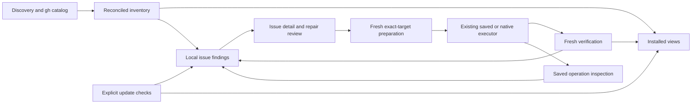

# SkillView product simplification and release plan

Research date: October 24, 2026, America/Chicago. Baseline: released `v1.0.1`, PR 41, commit `d6a578535e912876cd6f57158a6396fc94c0f4d7`. Current revision: PR 92 merged, `27efe94ddbde31ef3c8e6e7dbbee41c00c8b7177`.

**Approved direction: retain the reliable inventory and saved-operation foundations, remove peripheral features, and organize the product around Discover, Installed, and Issues.** The largest remaining gap is converting observations into a small, accurate set of problems with understandable repairs. Another broad maintenance framework would make that gap worse.

The intended public promise is: **Find skills, understand where they are installed, and fix supported installation problems with a clear review and a verified result.** Updates, duplicate/version disagreements, broken installations, and incomplete removals belong in that promise. Remove source publishing, Docker evaluations, and detailed simulation of agent configuration semantics from the product.

The maintainer has approved the deletion, removal and simplification direction. Those changes are requirements below, not open scope questions. This revision updates the plan; implementation remains a separate task. The retired 21-goal initiative stays retired. No product code was changed for this review or plan revision.

## Governing product requirements

**The highest-priority acceptance criterion is: A new user can search, review placement, install, and find the result in Installed without reading a technical guide.** Treat this as a release gate and a constraint on every delivery slice, not polish reserved for the end. Advanced power must remain available without making the ordinary path harder to understand.

- Make the main views answer what is installed, where it is used, and what can be fixed, upgraded or improved. Show known updates and issues alongside the affected skills, with visible actions and honest check freshness.
- Minimize separate windows, hidden workspaces and modal navigation. Use operation dialogs for review, confirmation, progress and results. Users must not enter one to discover that an update or problem exists.
- Replace the default flat inventory presentation with a clear representation of skills, their copies, and their agent/project relationships. Judge the representation by whether users understand it; adding more columns to the existing table is not sufficient by itself.
- Prefer supported `gh skill` capabilities and small adapters. Keep filesystem discovery and reconciliation because they reveal installations and problems outside gh's catalog. Keep custom repair code only for a concrete supported outcome or a necessary integrity/recovery guarantee that gh does not provide.
- Remove approved peripheral features and redundant abstractions, including their exclusive wiring, tests, dependencies and documentation. Preserve compatibility and recovery for retained user data. Minimize responsibilities and concepts rather than chasing a line-count target.

When an implementation choice adds complexity, identify the user outcome it serves and check whether gh or an existing SkillView path already supplies it. Choose the smaller implementation that meets the outcome and required guarantees. Speculative extensibility is not a justification.

## Comparison scope and evidence

The comparison uses the entire tracked tree between the two commits, including product code, tests, native proof tools, CI, documentation, and presentation assets. The commit history and PR metadata establish which work actually landed. Focused source review follows discovery, reconciliation, issue classification, comparison, install/update/cleanup, saved-operation lifecycle, UI navigation, and reporting. This is a product and architecture audit with concrete regressions, not a claim that every native-code line received a new security audit.

The annotated tag `v1.0.1` peels to PR 41's merge commit. PR 73 was **closed without merging**. Its GitHub comparison was 100 changed files, 9,282 additions and 304 deletions; the much larger expansion already present in current main came principally through PRs 42–72. Do not restore PR 73 or use its incomplete approvals framework as an implementation source. [PR 41](https://github.com/harder/gh-skillview/pull/41), [PR 73 and its retirement](https://github.com/harder/gh-skillview/pull/73), [PR 92](https://github.com/harder/gh-skillview/pull/92).

| Measure | PR 41 | Current | Meaning |
| --- | ---: | ---: | --- |
| Tracked product C# lines under `src` | 25,795 | 53,362 | A 107% increase; includes comments and blank lines |
| Tracked C# test/proof-host lines under `tests` | 15,373 | 42,888 | Excludes Python/C/shell proof tools |
| Core inventory C# lines | 7,199 | 14,948 | Discovery, identity, ownership, and native filesystem machinery |
| Core UI C# lines | 12,780 | 16,881 | More workflows and presentation states |
| Core CLI C# lines | 1,851 | 4,058 | More commands as well as the partial-file refactor |
| Maintenance C# lines | 0 | 8,856 | Saved update/recovery/comparison infrastructure |
| Agent loading-policy C# lines | 0 | 1,901 | Separate from ordinary physical discovery |
| Routed command names, excluding help/version | 9 | 62 | Distinct command strings in the dispatcher |

The net tree diff is **550 files, 81,094 insertions, 6,864 deletions**. The 81,094 figure is additions across code, tests, documentation and tooling; it is not 81,094 lines of new shipping application code. Of those additions, `tests/` contributes 35,394 and `agent_docs/` 8,066. File moves and refactors also affect these totals.

The PR 41 → PR 72 diff was 495 files, 165,680 additions and 1,603 deletions. PR 72 → current is 336 files, 22,335 additions and 112,182 deletions. Much of that later deletion was obsolete evidence and goal records. These ranges are informative separately; adding their insertion counts does not produce the final net diff.

Reproduce the census without checking out another branch:

```sh
git rev-parse 'v1.0.1^{commit}'
git diff --shortstat v1.0.1 27efe94
git diff --numstat v1.0.1 27efe94
git diff --dirstat=files,0 v1.0.1 27efe94
git log --first-parent --oneline v1.0.1..27efe94
```

### What changed by subsystem

| Area | PR 41 behavior | Current behavior | Assessment |
| --- | --- | --- | --- |
| Search, preview, install | Already usable; compact and advanced install, repository picker, filters | Mostly retained; stronger placement/ownership admission and correct versioned previews | Preserve and polish; this does not need a new search system |
| Physical inventory | Filesystem plus gh catalog, relatively simple ownership model | Namespaces, workspaces/profiles, managed deliveries, contextual ownership, completeness, physical identity | Valuable foundation for the primary product |
| Duplicate detection | Same name could select an arbitrary preferred copy by provenance/date/path length | All copies retained; name collision becomes review-only; explicit full-payload comparison | Correct safety improvement, but the repair journey is unfinished |
| Missing tracking | Absence from gh could become a source-orphan cleanup candidate | Coverage-aware, review-only untracked observation | Keep conservative semantics; missing tracking is not proof of damage |
| Updates | CLI/TUI largely delegated mutation to gh | Immutable candidate, source/local-change review, retained original, apply, recovery, undo | Worth keeping; considerably more friction and lifecycle responsibility |
| Version choice | Limited direct interaction | One-installation Git-tag selection using schema 2 | Useful, bounded feature from PR 78; keep |
| Cleanup/removal | Native removal already existed | Stronger identity/generation/owner checks, fewer unsafe automatic recommendations | Keep protections; classify issues separately from deletion eligibility |
| New maintenance features | No saved replacement framework | Schemas 1–6, local merges, unpin, reimport, source switch, quarantine, backup, plan references | Keep the parts supporting actual repair; reduce the default surface |
| Additional diagnostics | Doctor and inventory validity | Package checks, conditional effective loading, authoring validation, Docker evaluation | Keep package integrity checks; remove the other three product surfaces |
| Presentation | Three main tabs already existed | Better summaries, F2 evidence, copies view, update review and undo | Recent improvements are real; navigation still follows internal workflows |
| Performance | Smaller discovery workload | Broader discovery caused repeated path/owner work; PR 92 adds indexing and shared snapshots | Keep PR 92; establish benchmarks before further architectural changes |
| Release tooling | Existing tests/AOT/release pipeline | Much larger native proof matrix, old-schema compatibility proofs, dependency monitoring | Simplify with retired features, not by deleting coverage for retained behavior |

PRs 75, 77, 79–81 and 83 improved summaries, cleanup, copy comparison, update review and undo. PRs 82 and 85 addressed proof diagnostics and placement capture. PR 86 added manual acceptance tooling. PRs 87 and 91 handled dependencies and gh compatibility; 88 and 90 removed obsolete records and reorganized code. PR 92 fixed expensive inventory matching and repeated tab capture. These improvements should be the starting point, not reverted along with unwanted features. PR 74 was dependency automation. Numbers 84 and 89 were compatibility issues, not missing feature PRs.

## Findings ordered by product impact

### Issues are mixed with routine inspection opportunities

`MaintenanceQueueBuilder` appends `installation-review` for every distinct installation. `UpdateState` is permanently `unknown`; the queue does not retain an availability result. Changes counts these rows as maintenance observations, rather than showing an actionable issue total. This is explicit current behavior, not an accidental rendering bug. [Queue implementation](../src/SkillView.Core/Maintenance/MaintenanceQueue.cs), [Changes view](../src/SkillView.Core/Ui/Tabs/ChangesTabView.cs).

In the isolated seven-installation fixture, Changes displayed 12 rows: seven generic installation reviews, two name collisions, one broken link, one empty directory and one malformed skill. The healthy installation also received a review row. A user cannot readily tell whether their setup is healthy or whether five issues, twelve tasks, or seven installations need attention.

**Change:** make the default Issues list contain findings only. Keep routine inspection in Installed. Show separate counts for problems, available updates, informational differences, and incomplete checks. A clean inventory must have a meaningful empty state even before remote updates have been checked: “No local problems found. Updates not checked.”

### The repair offering is much narrower than the detection offering

Current cleanup can remove eligible broken links and genuinely empty ordinary directories. Malformed skills, name collisions, untracked copies, and metadata conflicts are generally review-only. Copies provides comparison and handoffs, but no consolidation. Static package findings do not feed the maintenance queue. Most “fix” routes therefore become inspection or a different workflow. [Classifier](../src/SkillView.Core/Inventory/CleanupClassifier.cs), [Copies](../src/SkillView.Core/Ui/CopiesScreen.cs), [package checker](../src/SkillView.Core/PackageChecking/StaticPackageChecker.cs).

**Change:** publish and implement a bounded repair matrix. For every issue, return a concrete supported action, a user decision that unlocks one, or a clear owner/tool limitation. Automated repair means SkillView executes the reviewed steps and verifies their result; it does not mean silently choosing a survivor, discarding edits, or assuming every same-name skill is interchangeable.

### Retained plans have no complete everyday lifecycle

`ReplacementPlanStore` caps retained plan directories at 16. Failed staging and skipped reviews can leave evidence. The UI explicitly retains skipped plans. There is no corresponding supported plan-retirement command or ordinary history UI that lets a user free that capacity safely. Increasing the cap only delays the problem. [Quota and admission](../src/SkillView.Core/Maintenance/ReplacementPlanStore.cs), [skip behavior](../src/SkillView.Core/Ui/Tabs/UpdatesTabView.Review.cs), [saved updates](../docs/saved-updates.md).

**Change before broad promotion:** add bounded history, interrupted-operation visibility, and explicit retirement of verified eligible operations. Distinguish abandoning an unapplied review from permanently discarding an applied operation's undo data. Keep unfinished, ambiguous, corrupt, or referenced operations protected. This is a new narrowly scoped destructive boundary and needs native/state ownership verification; ordinary path-recursive deletion is not an acceptable implementation.

### Pin information disagrees across views

`InstalledSkill.Pinned` reads only frontmatter, while `Revision.PinnedRef` and the queue also consider owner records. Installed's P filter and its detail summary use the former. A supported schema-3 lockfile with `pinnedRef` and no frontmatter pin produced `revision.pinnedRef = refs/tags/v1.0`, queue `pinned = true`, but Installed “Pinned: No”; P showed **0 of 7** rows. Reproduced with actual gh 2.103.2 at 80×24 and 120×36. [Installed filtering](../src/SkillView.Core/Ui/Tabs/InstalledTabView.cs), [detail summary](../src/SkillView.Core/Ui/InstalledScreen.cs), [model](../src/SkillView.Core/Inventory/Models/InstalledSkill.cs).

**Change:** one transient pin-policy projection for display, filtering and action explanation: unpinned, pinned, conflicting, or unknown. Use all contextual claims, preserve disagreement, and avoid changing legacy serialized fields/hashes as an incidental UI fix. Test lock-only pins and disagreement explicitly.

### Incomplete removal can leave an invisible record

Inventory preserves `OwnershipRecords`, including records without payloads. The queue is built from `Skills` and cleanup candidates, so it never independently examines those records. A fixture containing a valid `ghost-record` lock entry with no directory produced no issue for that record. [Inventory model](../src/SkillView.Core/Inventory/Models/InventorySnapshot.cs), [queue](../src/SkillView.Core/Maintenance/MaintenanceQueue.cs).

**Change:** detect a recorded installation whose expected payload is positively missing. Give it an identity based on the exact registry/context/selector rather than pretending a directory exists. Unknown placement or incomplete coverage must remain “Could not verify.” Start with a verified gh registry schema; shared interoperability records and third-party owners require more care than a generic delete-entry action.

### The visual inventory still hides the relationships users care about

Installed is a flat physical-row table with compact validity, scope and agent badges. It does not offer an explicit project/agent overview or a source/version comparison at a glance. The State badge reflects metadata validity or symlink form, not updates, owner conflict or package integrity. Package/source presentation often uses a single `Package` compatibility projection even though the model now supports multiple claims.

Changes shortens locations to a parent directory name. In the real fixture, two different copies both displayed `demo · skills`. A user must enter another view to identify them. Installed also resets sort when populating a new snapshot, while Changes selects row zero after loading. PR 92 preserves some state on cache hits; that does not solve refresh continuity. [Table and filtering](../src/SkillView.Core/Ui/Tabs/InstalledTabView.cs), [queue labels](../src/SkillView.Core/Ui/ChangesQueueBuilder.cs).

**Change:** distinguish logical skill/source, physical copy, and observed agent/project exposure. Use project names or shortest unique location suffixes in lists. Preserve selection by identity, filter, sort, and scroll across refreshes. Display “Valid metadata” separately from actual health; a symlink is an installation form, not a health grade.

### Common actions are spread across specialist screens

Updates is a hidden workspace accessed with `u`; Cleanup is a modal; Copies is another modal; package checks and effective loading are additional views. The global help omits several available actions, including the general update shortcut. Advanced actions appear in legends while the primary repair route remains less obvious. The 80-column detail pane is narrow and verbose even after recent improvements. [Navigation](../src/SkillView.Core/Ui/SkillViewApp.Navigation.cs), [help](../src/SkillView.Core/Ui/HelpOverlay.cs), [update controls](../src/SkillView.Core/Ui/Tabs/UpdatesTabView.Review.cs).

**Change:** surface update availability and issue summaries directly in Installed and Issues, with visible check and review actions. Retire the hidden Updates workspace as a discovery destination and integrate Copies and Cleanup information into the main views. Use one contextual action menu for secondary actions, consistent detail/review presentation, and clear return-to-selection behavior. Keep the existing execution coordinators underneath. Put actual source changes in an obvious Diff view; reserve F2 for technical evidence. Do not require users to understand “plan purpose,” raw archives or native identity to perform a normal update.

### Freshness and failure handling need clearer boundaries

PR 92's display cache is deliberately separate from mutation admission and should stay that way. It retains complete snapshots for one minute. Partial snapshots are retried on later visits. Ordinary startup still waits for the environment probe, including authentication, before inventory capture; a slow auth probe can delay local browsing. [Cache](../src/SkillView.Core/Ui/DisplayInventoryCache.cs), [startup](../src/SkillView.Core/Ui/SkillViewApp.Workspaces.cs), [probe](../src/SkillView.Core/Environment/EnvironmentProbe.cs).

Source review also found a failure-path risk: install result objects lack explicit mutation-attempt accounting, and several UI refresh paths depend on successful installation. A child can fail after making a partial change. This was not reproduced as a filesystem failure during the audit; it deserves a fault-injection test before concluding there is a current user-visible cache bug. [Install result](../src/SkillView.Core/Gh/Models/InstallResult.cs), [workflow](../src/SkillView.Core/Ui/SkillViewWorkflowCoordinator.cs).

**Change:** start local browsing without waiting for remote authentication, show capture time/completeness, and reconcile after every install attempt that may have changed disk. Distinguish a refused preflight from an admitted child that failed or was canceled. Avoid giving incomplete scans an aggressive automatic retry loop.

### Much of the new product surface has low relevance to the stated goals

Authoring validation wraps `gh skill publish --dry-run`. Docker evaluation adds explicit environments, prompts and isolation machinery. Effective loading models provider configuration merging, permissions, trust and version-specific rules while still declining to claim actual running-session state. These are substantial maintenance commitments for adjacent problems. [Authoring](../src/SkillView.Core/Authoring/AuthoringValidationService.cs), [evaluation](../src/SkillView.Core/Evaluation/IsolatedEvaluationRunner.cs), [loading](../src/SkillView.Core/Loading/EffectiveSkillLoader.cs).

**Change:** remove the authoring and evaluation product features. Replace detailed loading-policy simulation with observed locations, ownership, and concise reload guidance. Preserve discovery of managed/plugin skills and the protections against mutating them. Keep static package integrity checks that detect missing files or invalid metadata.

### Documentation and tests reflect the expanded implementation more than the product

The CLI grew from nine routed commands to 62. Its main help leads users through specialist plan families alongside ordinary tasks. `docs/architecture.md` still describes a “small command surface” and does not explain the maintenance subsystem. Website/README imagery largely remains the PR 41 product; the new repair promise lacks a corresponding demonstrable story.

The test suite contains valuable native and compatibility coverage, but some fixture assumptions are implicit. In this audit, separate `/tmp` mount topology and umask `002` caused failures unrelated to the intended behavior under test. Platform-specific early returns and opt-in tests also require care when interpreting totals.

**Change:** align help, docs, test organization and CI with supported user outcomes. Remove tests exclusively supporting removed features. Keep old-schema restart proofs while those schemas remain supported. Fix implicit fixture modes and mount prerequisites instead of relaxing product validation.

## Required user experience

Keep three top-level tabs: **Discover / Installed / Issues**. Rename Changes because users are looking for problems and repairs, not an unqualified count of observations. Doctor, operation history and advanced functions live in menus or contextual drill-ins.

Installed must show attention and update state beside each affected skill/copy, and Issues must collect the same findings by problem or action. Both use the same result and freshness model. Expose “Check updates” in the main view; show “Not checked,” progress, failure or a previous result without opening another workspace. Once checked, users can identify available upgrades and start review from either view. Checking remains explicit initially; discoverability does not require a startup network scan.

Browsing must stay in these views wherever practical. Use inline expansion or the existing detail area for copies, affected consumers, findings and comparisons. At narrow widths, a full-width detail page is acceptable with an obvious Back action. Reserve modal workflows for focused operation decisions, processing and results; remove redundant intermediate launchers and nested modal chains. Interrupted operations must also have a visible main-view indication even though detailed history lives elsewhere.

### Discover and install

Preserve search, rendered/raw preview, repository skill selection, and gh authentication. Add an installed indicator keyed by known repository plus skill subpath, never name alone. Let it say “Installed in 3 locations” with a direct jump to Installed.

The normal install review must answer: which skill, source/version, selected agents, project or user scope, exact resulting locations, and whether any existing copy conflicts. Group detected agents first and put the full catalog behind “More agents.” Explain project versus user scope in plain language and keep universal/shared placement explicit. Advanced flags stay expandable. A failed repository listing must offer retry or a clearly labeled explicit install-all choice, rather than automatically changing the apparent task. After a successful install, provide a visible “View installed skill” action that opens Installed with the resulting copy selected and its locations/agents visible. Preserve the search context when returning.

Add search pagination or “More results” using the adapter's existing page parameter. Avoid blocking all results on optional per-result agent metadata previews. Do not add recommendation feeds, another index, or a skill marketplace.

### Installed inventory

Make the default presentation a skill/source overview with expandable copies and agent/project exposures. Show copy count, locations, version agreement, update availability and problems without requiring users to mentally join physical rows. Preserve an exact physical-copy view for inspection and mutation targeting. Known common source identity can group copies; identical names with unknown or different sources stay distinguishable. Shared physical files must read as one copy used by multiple consumers, not several independent duplicates.

Before committing to the layout, compare two small representative layouts: a skill-first expandable list and a location/agent-grouped view of the same fixture. Use sketches or lightweight presentation prototypes, then select one default and reuse its detail component for the alternate filter/grouping. This is a bounded usability exercise, not a requirement to build two independent browsers. A table is appropriate where it makes comparisons easier; do not preserve the current table merely because it exists.

At comfortable widths, show **Skill, Version/ref, Location, Agents, and Attention** through the selected layout. At narrow widths, prioritize skill identity, useful location labels and attention, with relationships available through expansion/details. The detail view shows description first, source, scope/project, all observed consumers, and available actions. Put hashes, raw ownership claims, provider diagnostics and native evidence behind Details.

Provide explicit filters for agent, project/location, source/owner, and issue state, replacing obscure cycling as the only access. Reuse `--workspace`, `--profile`, and `--scan-root` discovery semantics. A small Locations dialog can add known workspaces and persist the selected roots; it must not become machine-profile management or a recursive scan of the entire home directory. Always show which projects were scanned and which are outside coverage.

### Issues and repair

Default groups: **Problems**, **Updates**, and **Review suggestions**. Make these groups and their counts visible in the main view, with direct navigation to affected Installed entries. Show incomplete discovery prominently but separately from broken skills. Group one duplicate family into one issue with its copies beneath it. Mark “Keep both” differences as intentional through a separate issue preference, not by misusing cleanup suppression as a universal health exemption.

Each selected issue has a short explanation, affected locations/agents, and one primary action:

```text
demo has different versions in 2 locations
  User             v1.0     Claude, Codex
  Project alpha    v2.0     Project agents

Choose: Review version alignment   Compare files   Keep both
```

A repair review follows the same visible sequence:

1. **Explain** the problem and what can be fixed.
2. **Review** the exact target, proposed change, file diff and affected consumers.
3. **Confirm** the applicable source and retention decisions.
4. **Apply** through the existing native/saved backend.
5. **Verify** fresh disk and ownership state; report resolved, unresolved or verification incomplete.
6. **Undo or inspect history** where the operation supports recovery.

Maintain separate source-review and retention decisions where required by current contracts. Simplify their presentation rather than silently removing an approval boundary. Plain labels such as “I reviewed these file changes” are sufficient, with the no-authenticity-assurance explanation adjacent to the diff. Opening a diff is not consent. Single-action broken-link/empty-directory cleanup can use a compact confirmation.

Batch repair first means a guided sequence with per-item outcomes. Prepare the next replacement only after the previous apply reconciles. A later batch action for homogeneous, independently validated cleanup must bind its reviewed targets and report exact partial progress. Do not add a universal “Fix everything” button.

### Terminal presentation rules

At 80×24, use a full-width list with Enter opening a full-width detail/review. At wider widths, retain the master/detail layout. Avoid squeezing every field into a permanently narrow preview pane. Keep title, location and primary action visible before secondary explanations.

Use a restrained theme, consistent spacing and status words alongside color. Provide high contrast without relying on emoji width. Standardize Enter for details/review, Escape for back, `/` for the active search/filter, `r` for disk refresh, and an explicit check-updates action. Preserve existing useful aliases during the transition. Help must reflect the active screen's actual actions.

Maintain selection and scroll on return, show “Refreshing” with the prior snapshot where possible, and block mutation against stale display data until fresh admission completes. Show operation progress and cancellation without allowing queued UI callbacks to outlive their owner.

## Detection and repair matrix

“Existing” means a backend exists within its present admission rules; it does not mean every possible installation is supported. New repair types below require their own bounded implementation and proof.

| Condition | Detection and confidence | Required action or guidance | Current status and release scope |
| --- | --- | --- | --- |
| Broken agent link | Target positively absent; exact link/parent captured | Remove broken link; retain target files untouched | Existing supported cleanup; make directly discoverable |
| Empty leftover directory | Exact ordinary directory empty, unowned, no protected consumers | Remove empty directory | Existing supported cleanup; distinguish from missing skill content |
| Available upstream update | Explicit remote check for exact source/installation | Review saved update, apply, verify, undo | Existing backend; add typed availability shared by Issues and Installed |
| Different recorded revisions of the same source | Source/subpath agree; revision domains comparable | Choose latest/tag or keep intentional difference; review each copy | Existing per-copy update/tag backend; new grouped workflow |
| Different installation methods | Compare owners, topology and contexts | Explain difference; offer only admitted update/removal options | New informational detector; different methods alone are not an error |
| Exact duplicate independent payloads | Same source, compatible revision, full comparison, compatible metadata | Review a chosen redundant copy; quarantine only if existing standalone admission allows | Comparison exists; automatic broad consolidation does not |
| Same name, different or unknown source | Name collision only | Compare and keep separate; let user acknowledge intent | Existing detection; lower default urgency and never select an arbitrary survivor |
| Missing or corrupt SKILL.md with known source | Preserve raw original; verify exact source independently | Restore/reinstall reviewed source with retained original | Existing planners require valid tracking in several paths; add a dedicated narrow repair admission rather than bypassing it |
| Missing referenced package file | Static captured package check, supported Markdown/reference grammar | Restore known source or open exact local file | Checker exists; connect result to Issues and source repair |
| Locally edited tracked skill | Compare installed/base/candidate when requested | Keep local or review replacement with retained original; show the diff without a built-in merge editor | Existing comparison/replacement retained; remove new merge creation; do not hash every payload at startup |
| Lock record whose payload is missing | Complete contextual coverage plus positively absent target | Review exact registry entry; remove stale record or reinstall if ownership is supported | Detection gap; new gh-specific repair, no generic third-party registry editing |
| Conflicting owners or metadata | Retain all disagreeing claims | Explain conflict and direct user to owner; repair only a proved supported transition | Existing diagnostics; do not automatically rewrite one side |
| Interrupted SkillView operation | Existing saved operation and live-slot inspection | Resume or undo exact operation | Backend exists; add startup/history visibility and guided recovery |
| Managed/plugin-owned problem | Observed managed ownership | Explain owning tool and how to inspect/update there | Preserve read-only management; automatic plugin mutation excluded |
| Missing scan coverage | Provider error, inaccessible root or configured-root omission | Retry selected location or adjust configured roots | Existing evidence; never report “healthy” or “orphaned” from unknown state |
| Pinned older version | Recorded intentional policy | Show pin; offer separately reviewed unpin if supported | Existing; not a defect merely because a newer version exists |

A source-unavailable check must distinguish deleted content from authentication, rate limits, network failures and an unrecognized remote response. A 404 alone is not permission to delete a local installation. Authored version text, Git ref, Git tree and distributor version remain different facts.

For the first promoted repair release, require working end-to-end stories for updates/undo, broken links, empty residue, version disagreement, and one genuinely broken known-source package. Include stale-record detection even if the initial action is qualified guidance. If advertising automatic stale-record cleanup or duplicate consolidation, the corresponding native action must also meet the release gate; comparison alone cannot be marketed as a fix.

## Required removals and simplifications

### Required removals

Execute these removals as part of the delivery scope. Caller and compatibility audits determine which shared readers or primitives must survive; they are implementation checks, not a reason to reopen the approved removal decisions.

| Surface | Concrete deletion targets | Why | Dependencies to retain or adjust |
| --- | --- | --- | --- |
| Authoring validation | `Authoring/`, `CliDispatcher.Authoring.cs`, `authoring-validate` routing/help, dedicated tests/proof/docs | Source publishing is already gh's job and is outside everyday installed-skill repair | Point source authors to gh documentation; remove its CI proof steps |
| Isolated Docker evaluation | `Evaluation/`, `CliDispatcher.Evaluate.cs`, `evaluate-review/run`, dedicated tests/proof/docs | Adds runtime/image/prompt/isolation responsibility unrelated to installation correctness | Keep static package checks; no replacement evaluation framework |
| Detailed effective loading | Policy/config merging in `Loading/`, `CliDispatcher.Effective.cs`, `EffectiveLoadingScreen`, dedicated policy tests/proofs | High provider-version maintenance cost; still cannot establish actual loaded session state | Preserve managed discovery, physical exposures, explicit custom roots, reload guidance; separate the small static compatibility definitions used by package checks before deletion |
| Duplicate generic CLI facade | `CliDispatcher.Maintenance.cs` plan-file dispatch and `MaintenancePlanReference` after a compatibility audit | Adds another vocabulary over the same specialist operations; `repair` currently means resuming a transaction, not fixing a skill | Preserve saved-plan readers and direct recovery entrypoints; do not erase history referenced by callers |
| Local merge editor and new merge creation | Merge-choice UI, new-plan creation routes, dedicated creator tests/docs | A built-in merge editor adds a specialist authoring workflow to routine maintenance | Keep file comparison, keep-local and reviewed replacement choices; retain inspection, recovery and undo for existing schema-3 plans and shared metadata primitives |
| Obsolete scaffolding | Unused classifier branches/kinds, test-only fallback presentation, outdated phase comments, private unused helper types | Makes supported behavior harder to identify | Trace callers and JSON contracts first; retain historical wire values if needed |

The first three removal groups currently occupy **6,868 lines across 37 dedicated files**, including **3,196 product C# lines**. This count includes their dedicated tests, proof scripts and guides and excludes shared files. It is an opportunity estimate, not an exact deletion promise: shared compatibility definitions and replacement guidance remain. Wiring and CI removals may add savings. The generic facade/comparison-reference files are another 242 lines before related tests; do not count all of that as independently removable without checking uses.

These removals must eliminate responsibilities and their exclusive support code. Do not merely hide the features or move their implementation into another folder. They will not remove the entire 81,094-line diff, and they must not be inflated into a numeric deletion target.

### Keep and simplify

| Foundation | Decision |
| --- | --- |
| Physical identity, contextual ownership and partial coverage | Keep. They directly prevent incorrect duplicate/removal decisions. Simplify projections and repeated calculations, not evidence boundaries. |
| Managed skill discovery | Keep visible inventory and owner protection. Collapse redundant matching helpers only after equivalent-case tests. |
| Saved updates, exact tag selection, recovery and undo | Keep as the normal update mechanism. Hide implementation vocabulary and add operation history/retirement. |
| Static package checks | Keep metadata and missing-resource diagnostics; run deeper checks on demand. Keep declarations informational rather than inventing broad behavior/security judgments. |
| Pin/unpin and local reimport | Keep contextual actions. Hide them when inapplicable and explain unavailable capabilities before expensive preparation. |
| Local source switch | Keep advanced, as it serves a specific installed-local-skill repair; no broader source-adoption platform. |
| Existing local merge plans | Keep schema-3 inspection, recovery and undo. Remove the editor and new merge creation as required above; local edits remain reviewable and preservable without a built-in merge tool. |
| Source review | Keep immutable diffs and independently bound acknowledgement. Simplify presentation and duplicated report construction. |
| Quarantine and backup | Keep backend recovery capabilities. Prefer user-oriented “Move aside” and history where admitted; raw backup capture is an advanced diagnostic. |
| Native removal and state primitives | Keep supported backends and refusal rules. No managed recursive-delete replacement or blanket metadata loss. |
| Cancellation, dispatch, task ownership, bounded output | Keep. These underpin fast navigation and predictable shutdown. |
| Six NuGet locks and four native release targets | Keep unless a separate product/platform decision changes support. |

The six files most directly associated with merge creation/choice UI total 1,016 C# lines, but their dependencies also serve other plans. Removing the visible editor does not automatically remove native metadata infrastructure. Do not promise large savings by counting shared support twice.

The earlier native removal backend already existed in PR 41. Rolling the app back wholesale would restore unsafe same-name cleanup decisions and lose supported recovery. The better simplification is to narrow the set of operations users can initiate, then remove the code and tests exclusively serving retired operations.

### Compatibility during deletion

Separate three kinds of compatibility:

1. **Released CLI behavior:** compare against PR 41. In particular, ordinary `update` now prepares review rather than simply behaving like the old mutating wrapper. Document and version this intentionally; use a major release if the supported CLI contract remains incompatible.
2. **Unreleased commands introduced on main:** these can be retired more freely, but review repository callers, proof scripts and user documentation together. Offer a short migration note; do not silently reinterpret an old command to perform a different action.
3. **Persisted user data:** schemas 1–6, retained originals, journals, preferences and supported recovery records remain readable. Removing a creator does not authorize deleting its recovery reader or old-native compatibility tests. A genuine format retirement needs an explicit migration/export decision.

No new global transaction abstraction, plugin system, service registry, event bus, or general schema migration framework is needed for these changes.

## Implementation design

### Use gh skill before adding custom machinery

For each retained workflow, verify the supported gh command/options against the minimum and current supported versions before changing the adapter. Prefer structured output when available; keep narrow tested parsing where it is not. Recheck these boundaries as upstream improves, and delete superseded custom code when gh supplies the same behavior and required guarantees. Do not introduce a general capability framework to perform this review.

| Responsibility | Required boundary |
| --- | --- |
| Authentication, search, repository skill listing, source retrieval and normal install | Reuse gh's supported behavior through existing adapters wherever it meets the workflow; do not build a parallel catalog, resolver, credential store or installer. |
| Update discovery and source/version semantics | Prefer gh's supported checks and resolution. SkillView adds typed freshness, cross-installation presentation and review; it must not invent a competing definition of an upstream update. |
| Installed catalog and filesystem supplement | Combine gh records with observed files, links, managed deliveries, project roots and contextual owners. Keep evidence of untracked, broken, absent or conflicting installations that gh alone cannot explain. |
| Safe update/apply/recovery | Reuse gh within the current saved-candidate workflow where appropriate. Preserve immutable review, retained originals, exact-target admission and recovery when direct gh mutation does not provide those guarantees. Audit redundant staging/resolution helpers instead of assuming every existing layer is needed. |
| Repair of installation problems | Use a supported gh operation when it addresses the exact target and required outcome safely. Otherwise implement the smallest custom operation for the demonstrated filesystem/ownership problem, with explicit verification and recovery. |

Every custom adapter, detector or executor added or materially revised must identify the missing upstream capability or guarantee it supplies. Prefer deletion of duplicate paths and convergence on one supported execution route. Do not replace necessary filesystem evidence or native safety with an opaque command call, and do not preserve custom machinery solely because it already exists.

### A small issue projection over the existing snapshot

Introduce a transient issue result that carries kind, severity, confidence, subject or registry selector, affected installations/exposures, evidence timestamp, completeness, and an available action with its reason. Keep installation observations separate. The issue model is presentation and planning input; it never supplies mutation authority.

Use a straightforward set of pure detectors over reconciled inventory. Keep existing bounded filesystem observations where necessary, but do not disguise fresh I/O as a pure snapshot property. Start with broken/empty/malformed/conflict findings, then duplicate families and absent-payload owner records. Existing cleanup classification becomes one input or a narrower cleanup eligibility service rather than the universal definition of health.

Use group identities only for presentation. Expand a selected action to exact physical installation IDs and captured paths; fresh inventory must resolve those uniquely before preparation. Registry-only findings need a separate exact record selector. Preserve the current queue JSON schema or introduce an explicitly versioned issue envelope rather than silently changing its meaning.

### Availability with explicit freshness

Keep checks separate from planning. Store typed availability by exact installation/source/ref/pin context plus capture generation, gh version and check time. Suggested states: not checked, checking, current, update available, pinned, unsupported, failed, and stale. Do not treat unparsed text or a successful empty process output as proof of currency.

Reuse the existing gh dry-run adapter and exact-target coordinator. Its output is textual, so retain parser fixtures against minimum/current gh and represent ambiguous outcomes honestly. The official update command still offers dry-run rather than structured update JSON. [Upstream update contract](https://cli.github.com/manual/gh_skill_update).

Deduplicate remote source resolution where the source/context really is identical, with bounded concurrency and no shared mutation approval. Explicit refresh invalidates incompatible observations. Show a previous check as stale when disk/source context changes; do not erase it and imply “never checked.” Provide a visible “Check updates” action and publish results directly into Installed and Issues. Remove the separate update-discovery workspace. Background checking is outside this release's required scope; keep the first implementation explicit and responsive.

### One review presentation with existing executors

Add a shared review presentation model containing the user-facing change, scope, consumers, diff summary, recovery promise, required acknowledgements, unavailable reasons and exact backend reference. This replaces duplicated UI formatting/state transitions; it does not replace `SavedUpdateCoordinator`, `ReplacementPlanStore`, or native admission.

Model view states explicitly: loading, ready, preparing, reviewing, applying, verifying, completed, canceled and recovery needed. Avoid growing another collection of independent booleans across every screen. Keep existing operation leases and UI-generation guards; introduce the state model incrementally around one workflow.



### History and retention

Provide a bounded existing-only index of saved operations showing skill, action, date, status, original/candidate/retained locations, approximate retained size and available inspection/undo/retirement actions. Derive it from the existing stores; do not create a second authoritative journal.

For unapplied plans, retirement must establish that no original was moved, no owner write remains unfinished, no child merge/reference depends on the data, and no active lease exists. For completed operations, separately confirm loss of undo and verify that retained locations still belong exclusively to that operation. Unknown or partially published state stays inspectable and protected. Add quota guidance before expensive staging, but never automatically evict recovery data.

### Code organization

Keep the current Core project and feature partials initially. PR 90's file split is useful but not itself a reduction in conceptual coupling. Extract small projection and orchestration units when a delivery slice needs them; do not begin with a solution-wide clean-architecture rewrite.

Centralize display policy for pin state, source/owner summary, completeness, health, action availability and location labels. Keep persisted wire DTOs separate from those projections so a display improvement cannot change saved hashes. Centralize action labels/shortcut metadata enough that help and rendered actions cannot drift apart. Avoid reflection-heavy command frameworks because Native AOT is a product constraint.

Review native code sharing by role: held handles, traversal, state publication, owner registry coordination and payload evidence are distinct responsibilities even when their helper names look similar. Consolidate only proven duplicates with tests for both platforms/roles. Keep the low-level native layer outside UI presentation.

## Delivery sequence and completion criteria

Use these as bounded delivery slices, each potentially split into a few small PRs. They are not parallel autonomous goals. Finish and review a slice before expanding its scope. Establish the search-to-install-to-inventory walkthrough before A, rerun it after each affected slice, and fix regressions in that slice. Discovery usability must not wait for G. The first deletion slice can proceed alongside a narrowly independent presentation fix only if explicitly assigned that way.

### Implementation and review rounds

Use **GPT-6.1 Sol with high reasoning** for implementation. Use **Claude Sonnet 5.5** for small, contained reviews and **Claude Opus 5.5** for changes spanning ownership, native mutation, saved-operation compatibility, or substantial workflow redesign. Give each reviewer the concrete diff, acceptance criteria and verification evidence. Resolve actionable findings and obtain a review of material fixes before starting the next round.

Merging is authorized after **both GPT-6.1 Sol and Claude agree that no remaining issues require fixes**, with required checks passing on the final head. Whenever Sol fixes a Claude review finding, always request another Claude pass before merging. Reconcile branch updates and review material conflict resolutions under the same rule; a review of an earlier version is not approval of changed code. Bind the merge to the approved head SHA. After merge, verify ancestry, fetch/prune, update the primary checkout and remove the merged branch/worktree according to `AGENTS.md`, preserving unrelated edits and recovery data.

Keep each batch independently reviewable in a dedicated commit or PR with one clear user outcome or removed responsibility. Split the deletion slice by feature rather than combining every removal into one large change. Record scope, checks and review results with the batch. Keep implementation sequential where batches touch the same code or rely on changed behavior; do not turn these rounds into a new autonomous goal program.

The opening batch corrects read-only pin presentation/filtering and distinguishes same-name copy locations. It preserves serialized fields and mutation admission. Queue/issue semantics and each peripheral-feature removal follow in their own batches. Automated walkthroughs provide regression evidence throughout; the uncoached new-user release gate still requires observation with unfamiliar users.

| Slice | Result | Main code | Completion criteria |
| --- | --- | --- | --- |
| A — Correct the current story | Honest issue counts, pin state and unique location labels | Queue, health/pin projections, Changes/Installed formatters, help | Healthy fixture has zero local issues; lock-only pin visible; copies distinguishable at 80 columns; no saved schema change |
| B — Remove peripheral responsibilities | Authoring, evaluation, loading-policy simulation, generic CLI facade and new merge creation removed; obsolete scaffolding deleted | Dedicated folders, CLI/UI wiring, package dependency, tests/native/CI/docs | No active removed-feature entrypoints or exclusive support code; retained discovery/package checks pass; existing saved operations still inspect/recover |
| C — Make inventory understandable | Skill/copy/consumer representation, project/agent filters, stable selection and responsive layout; redundant browsing modals removed | Installed/Issues/Copies presentation, small Locations settings | Bounded layout comparison completed; user identifies copies and shared consumers without CLI; refresh preserves context; both terminal sizes usable |
| D — Turn checks into visible findings | Typed availability plus duplicate/version/method findings and stale-record detection in the main views | Issue projection, gh update-check adapter, shared Installed/Issues state, package checks | Check action and update results visible without opening a workspace/modal; current/available/pinned/unknown/error stay distinct; no startup network scan or payload hashing; incomplete coverage never implies absence |
| E — Complete repair and history | Common operation review, guided existing fixes, history/recovery/retirement | Workflow coordinator, saved/native backends, history UI | Review starts from the visible skill/issue; update→verify→undo works; broken/empty cleanup direct; results return to original context; >16 reviewed operations possible via safe retirement |
| F — Add missing high-value repairs | Known-source broken-package restoration; bounded record cleanup; narrow duplicate remediation where support is proven | Dedicated admission layered onto existing executors | Exact bytes/owners/consumers preserved; no arbitrary source/survivor; restart/undo proofs on advertised platforms; every refusal explains the next step |
| G — Complete discovery polish and performance | Clear install placement, installed indicators and handoff, pagination, local browsing independent of auth | Discover/install, existing gh adapters, environment probe, display cache | New-user walkthrough passes without coaching; failed admitted installs reconcile; no duplicate gh capability added; measured budgets pass |
| H — Qualify the public release | Cohesive docs/demo, supported-action matrix and compatibility story | Usage/README/site/assets, acceptance runner and CI | Release gates below pass on the chosen head; claims match demonstrated repair capabilities |

A and B deliver immediate value without inventing a new mutation mechanism. C and D make the central product understandable. E is necessary before promoting routine repeated maintenance. F closes the selling-point gap and has the highest uncertainty. G must use measurements to select optimizations; it is not permission for an unlimited performance rewrite.

For F, implement one operation at a time. Begin with a corrupt/missing package whose exact source can be established from supported ownership records. Then add stale gh-record cleanup. Duplicate consolidation must stay a separate narrow proposal if it requires consumer retargeting, cross-volume movement, third-party owner changes, or a new topology journal. Existing standalone quarantine can support only the cases it already admits; it cannot be relabeled as universal consolidation.

Each implementation PR must state the user-visible before/after, invariants affected, deletion/added responsibility, gh capability reused or missing, verification, and a concrete stop condition. Remove redundant helpers, entrypoints and tests with the feature they serve. If a slice starts requiring another general framework, return to the specific user case and reduce it before proceeding. Do not attach all deferred features as dependencies of release.

## Performance and reliability targets

PR 92's recorded ARM64 Mac measurement reduced a 168-row capture from 36.9–51.9 seconds to 2.39 seconds; its four-skill native PTY measured tab readiness at 47–133 ms. These are workload-specific historical measurements, not measurements from this audit or cross-platform guarantees. [Performance analysis](inventory-performance.md).

This audit's seven-row Linux managed build reached Installed in about 1.04 seconds at 80×24 and 1.58 seconds at 120×36. Changes became ready in about 0.34/0.43 seconds; the harness includes a 0.2-second settling interval. CLI list/queue/cleanup captures took about 0.30–0.32 seconds with network blocked. These small samples establish workflow viability, not benchmark percentiles.

Proposed release budgets, to be calibrated on ordinary supported hardware:

| Workload | Target | Measurement |
| --- | --- | --- |
| Initial shell | Interactive within 500 ms | Process launch to input-ready shell, independently of inventory/auth |
| Typical inventory, about 200 copies and 50 roots | Complete within 3 seconds warm, 5 seconds cold | Record phase timings, gh child count and coverage |
| Return to a cached tab | p95 below 150 ms | At least 30 actual terminal transitions, including redraw |
| Local filtering/navigation | p95 below 50 ms at 1,000 rows | Input to selected/rendered state; no filesystem I/O in draw handlers |
| Explicit refresh | Preserve browsing state and remain cancelable | New generation cannot publish obsolete results |
| Long remote work | Immediate progress, bounded timeout, responsive cancel | Distinguish remote wait from local work |
| Repeated use | No cumulative unbounded tasks, handles, memory or retained-state surprise | Repeated refresh/review/cancel and quota-boundary exercises |

Keep the shared complete display snapshot, capture-local indexes and four-child root-probe limit. First optimize auth/startup coupling and redundant post-operation captures. Add progressive inventory only if measurements show an unmet need; provisional rows must visibly lack complete ownership and must never become repair authority. Avoid file watchers, persistent disk caches, background daemons or a scan database until a measured problem requires them.

## Verification and release gates

### Verification performed for this review

The local source stayed at `27efe94`; the existing untracked `paseo.json` was left alone. No install, update, cleanup apply, removal, or recovery was run against the maintainer's skills.

| Check | Result and limit |
| --- | --- |
| SDK/runtime | Exact SDK 10.0.113 and runtime 10.0.13 available on Ubuntu 26.04 x64 |
| Locked restore | Initial shared cache failed NU1403 for ILCompiler/ILLink; cached packages came from Ubuntu `/usr/lib/dotnet/library-packs`. Isolated NuGet cache and disabling that offline package source passed without changing locks. |
| Build | `dotnet build --no-restore` passed, zero warnings/errors |
| Default full suite | 2,845 total: 2,774 passed, 37 failed, 34 skipped. `/tmp` mount topology caused placement refusals; several no-op fixtures also differed in mode. |
| Full suite with private `/var/tmp` | 2,804 passed, 7 failed, 34 skipped. All remaining failures were in `SharedReplacementRevisionTests`. Integration project passed. |
| Remaining class with umask 022 | All 69 tests passed. Original shell umask was 002; fixture directories were 0775 while candidates were sealed as 0755. This is a fixture portability issue; retaining permission differences as meaningful is correct. |
| CLI fixture | Actual gh 2.103.2, isolated HOME/CWD/state/config, network blocked; list/queue/cleanup inspection succeeded and exposed queue/pin/absent-record findings |
| Terminal walkthrough | Built Linux managed executable at 80×24 and 120×36; startup, Installed, Changes, pinned filter and Ctrl+Q verified; both exited zero |
| Other platforms and live remote mutation | Not rerun in this research task; existing PR evidence is historical and must not be substituted for the eventual release head |

The combined test runs explain and cover the observed failures, but are not a single full-suite pass under the corrected environment. Fix fixture permissions explicitly and record mount prerequisites in the test runner. Do not change native equality or mount guards to make these tests pass. The restore issue also deserves a documented Ubuntu contributor workaround instead of lock regeneration against distribution-repacked packages.

At review time the GitHub connector returned a successful CodeQL run and a pending CI run for PR 92's final head, with no jobs returned for that CI run. That limited snapshot is not evidence of either a green final matrix or a failed product. Release qualification should inspect completed results on the actual release commit. [Reported CI run](https://github.com/harder/gh-skillview/actions/runs/40155365233).

The installed gh is 2.103.2; current repository compatibility reports cover 2.103.1. Keep the 2.97.0 minimum unless intentionally changed. Run minimum/latest contracts again for release rather than treating the version on this machine as a complete compatibility verdict. The upstream skill surface remains in preview. [gh skill manual](https://cli.github.com/manual/gh_skill), [install semantics](https://cli.github.com/manual/gh_skill_install).

### Product acceptance

**Primary release gate: A new user can search, review placement, install, and find the result in Installed without reading a technical guide.** Validate this with people unfamiliar with SkillView, not only scripted keystrokes. Give them the task without UI instructions; observe whether labels and visible actions lead them through it. They must be able to explain the chosen scope/agents and find the installed copy afterward. A completion that needs coaching, an undocumented shortcut or an external technical guide does not pass. Repeat after material navigation changes, and cover both narrow and wide layouts in terminal acceptance.

Use a single small “messy inventory” fixture as a repeatable user story, plus isolated native fault fixtures. It should contain a shared payload, independent duplicates, an intentional project override, mismatched recorded revisions, a lock-only pin, malformed metadata, a missing resource, a broken link, an empty leftover directory, an absent-payload owner record, a managed read-only skill, and an inaccessible location.

Require these outcomes:

- A new user can search, review placement, install, and find the result in Installed without reading a technical guide.
- They can identify which copies and projects use a skill and which consumers share physical files, without manually correlating ambiguous table rows or visiting several specialist screens.
- They can discover available upgrades, affected copies and repair opportunities directly in Installed and Issues. The check action and freshness/error state are visible; no hidden workspace, modal or undocumented shortcut is needed to discover an update.
- Review, confirmation, progress and results use focused operation flows that return to the originating selection. Copies, cleanup findings and update discovery do not require separate nested browsing workflows.
- A clean inventory shows no invented problem count; intentional differences can be acknowledged without suppressing unrelated faults.
- Updates are checked explicitly through supported gh capabilities, reported in the main views with freshness, reviewed, applied to an exact copy, verified, and undone where advertised.
- A broken-link and empty-directory repair each remove only the reviewed object; genuine content and shared consumers remain intact.
- A broken known-source package can be repaired through the promoted workflow, with the original retained and a verified result.
- Duplicate/version repair claims match the supported actions. At least one duplicate-related repair story completes; unsupported consolidation has specific guidance.
- Interrupted operations are visible after restart. Changed targets, partial coverage, owner conflicts, cancellation and disk-full failures lead to accurate outcomes and preserved recovery evidence.
- Retained plans can be managed without an undocumented manual filesystem cleanup after sixteen reviews.
- Ordinary unprivileged accounts on each advertised OS can perform the normal advertised repair path. Advanced metadata-dependent refusals are explained before work; CI administrator privileges must not stand in for normal-user acceptance.
- The whole walkthrough works at 80×24 and a larger size, using keyboard-only controls, readable status text and high contrast.

### Technical acceptance

Keep locked restore, warning-free builds, relevant formatting, existing managed tests, and sequential product AOT publishes. Preserve the four supported RIDs and active native proofs for retained operations. For changed mutation paths, prove native identities, owner-byte preservation, affected/retained exposures, cancellation at destructive boundaries, process-kill recovery and old-schema restart behavior.

After deleting a feature, remove only its dedicated CI steps and proof-input dependencies; recalculate aggregate gates and artifact expectations. PR 76/90 already improved CI organization. Avoid an unrelated new CI framework. Keep fast presentation tests separate from slower actual-gh/native acceptance, and report executed, skipped and unsupported cases honestly.

The removal pass is complete only when retired features have no active UI/CLI entrypoints, exclusive implementations, unused dependencies, misleading help, or dedicated CI obligations. Keep shared and historical recovery support explicitly identified. Verify gh adapters against the supported minimum/current versions and record why each remaining custom execution path is necessary for filesystem coverage, a supported repair, or an integrity/recovery guarantee.

Update `docs/usage.md`, `docs/architecture.md`, focused contracts and `CONTRIBUTING.md` with the final product. Replace screenshots and animations using the qualified build. The public demo should show **an issue found, a clear repair, a verified result, and undo**, in addition to discovery and inventory. Make the supported-action matrix easy to find. Do not advertise “fixes all skill problems,” universal duplicate consolidation, or knowledge of active agent sessions.

## Approved scope and implementation boundaries

The removals and simplifications in this plan are required. Remove authoring, Docker evaluation, detailed loading-policy simulation, the redundant generic CLI facade, new local-merge creation/editor, and obsolete scaffolding. Preserve supported saved-data inspection, recovery and undo. Integrate inventory relationships, update discovery and issue visibility into the main views; retire redundant discovery windows and modal chains. Prefer gh capabilities and remove custom duplication wherever the required behavior and guarantees are preserved.

The first promoted release must satisfy the primary new-user journey and the bounded repair stories above. Start missing-package repair with an exact source established by supported ownership records. Broad duplicate consolidation involving consumer retargeting, cross-volume moves or third-party owner migration remains outside this release scope. Deliver the specified version-alignment and admitted redundant-copy repair paths; do not call comparison or version alignment “consolidation.”

Begin implementation by establishing the primary walkthrough, correcting the confirmed defects and issue projection, and deleting peripheral features. Carry the usability gate through each slice. Do not revive PR 73, rewrite the native layer wholesale, or add another broad goal ledger.
