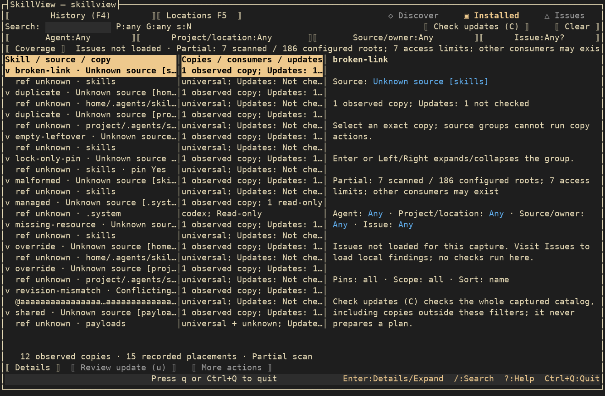
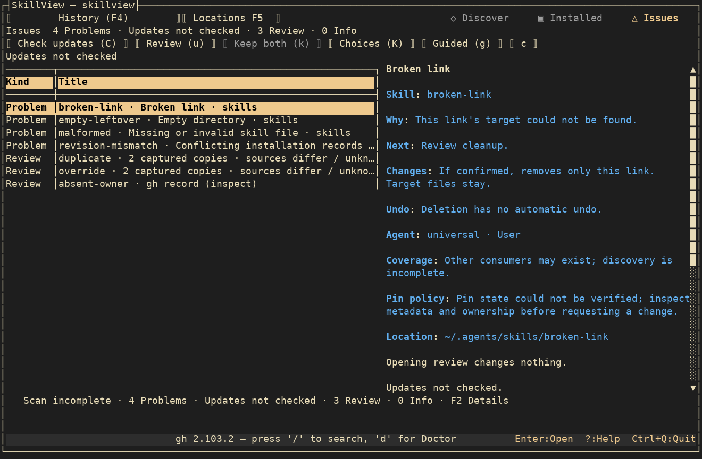
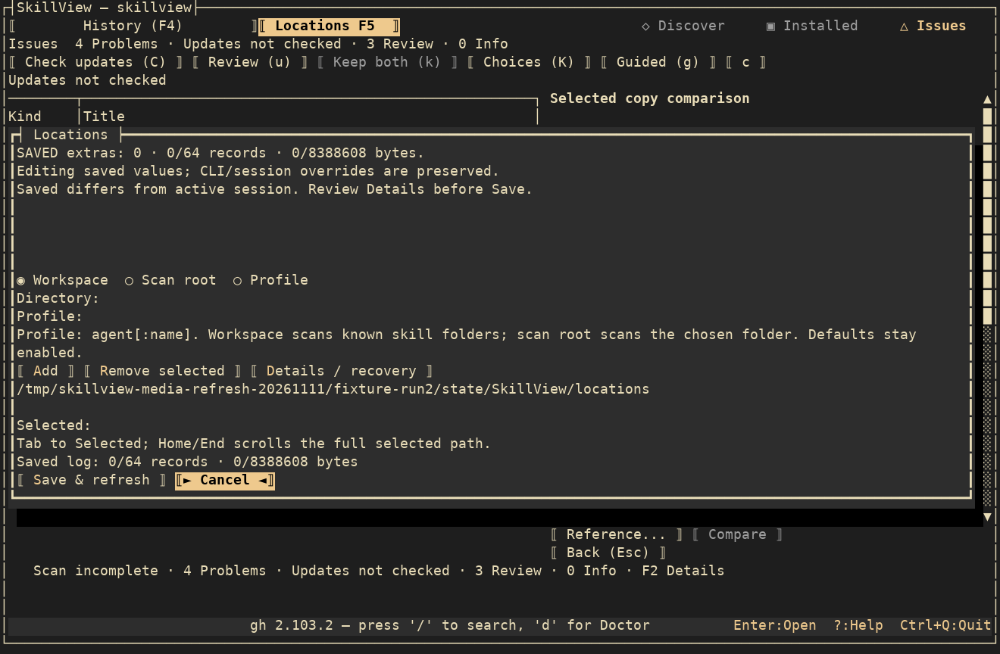
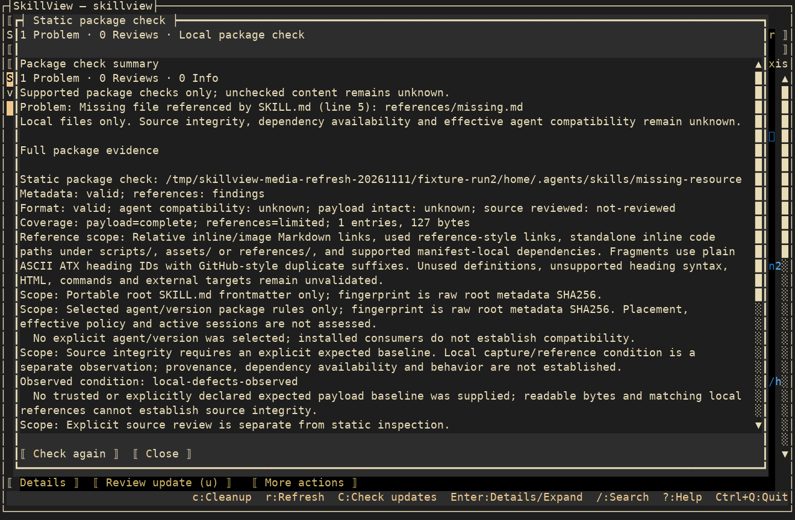
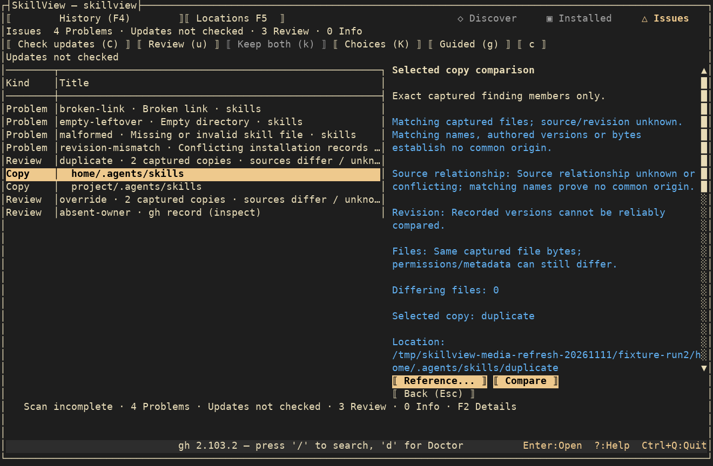

# Find, diagnose and fix skills

This guide describes the development version; check your installed binary’s `--help`
for available commands.

Start with the symptom below. SkillView observes files and recorded ownership;
it does not know whether a running agent has loaded a skill. A scan, suggestion,
comparison or package check never approves a write.

| What you want to do | Start here | What to review next |
| --- | --- | --- |
| Find a skill to install | Discover: search by topic, narrow by repository owner, preview `SKILL.md` and associated files; CLI `search` / `preview` | Standard or advanced install reviews version, selected skills, scope, agents and destination. Advanced options cover a custom path, local source, upstream source and hidden directories. |
| Find skills already on disk | Installed, including user/project agent directories, universal/shared copies and observed managed or plugin payloads; CLI `list --json` | Filter by Agent, Project/location, Source/owner, Issue, pin or scope. Expand a source heading and select an exact physical copy to see all recorded consumers. |
| Include another project, custom directory or profile | F5 Locations; CLI globals `--workspace`, `--scan-root`, `--profile` | Workspaces scan known skill locations; scan roots name exact skills folders; profiles label explicit skills folders. CLI subcommands do not load saved TUI Locations. Coverage shows unavailable and omitted locations. |
| Understand an unhealthy-looking inventory | Issues, Installed Coverage / F2, `queue --json`, `inspect --path PATH --json` | Broken links, empty residue, malformed files, record conflicts, same-name/source/revision/method families and unmatched registry observations have different meanings. Refresh after a filesystem change. |
| Check missing files or package metadata | Select an exact Installed copy, then K / Check package; CLI `check --path PATH --json` | Bounded static metadata, Markdown references, literal dependencies and portability evidence. Skill code and AI clients are not run. Unknown compatibility, dependency availability and source trust stay unknown. |
| Compare copies before deciding | Expand an Issues family, select an exact child, Enter, choose Reference then Compare; Installed More actions also offers broader comparison; CLI `compare` | Raw/normalized file differences, modes and source/revision facts. Matching content does not prove redundancy or safe deletion. Keep both / Choices records an intentional difference without editing payloads. |
| Check for a newer revision | Installed or Issues C / Check updates; CLI `update --all --dry-run` | Availability is explicit and separate from preparing an update. Not checked, unknown, pinned, stale and failed are distinct from current. |
| Replace an eligible copy with reviewed source | Exact copy u / Review update, or Choose version for one Git tag; CLI `update-plan` | Review the immutable source Diff and affected consumers, acknowledge the source, then separately approve retention of the original. Prepare the next item after reconciliation; there is no Apply all. |
| Repair a missing resource | K, then an eligible Installed More actions resource-replacement review | This replaces the whole package, not just one file. The saved comparison must establish the exact missing resource; local edits/extras are retained for fresh Undo. Partial or unsupported cases remain diagnostic. |
| Restore the recorded revision or damaged tracked copy | CLI `restore-plan`; for an attached compatible gh record, More actions → Review registry-recorded replacement / `registry-restore-plan` | These are different purposes. Registry-recorded replacement needs a physical copy and corroborating evidence; an unmatched registry row is inspect-only. Neither workflow deletes registry-only observations. |
| Refresh or change an ownerless local source | More actions → local reimport / source switch; CLI `reimport-plan` / `source-switch-plan` | Reimport uses the recorded local source; source switch selects a different durable local directory. Review source and retention separately. No new automatic local merge is created. |
| Change a pin | Purpose-specific unpin review / `unpin-plan` | Pin-only change preserves content and recorded source revision. Existing pins need a separate unpin review before choosing an update tag. |
| Remove residue or an exact unwanted copy | Issues c / Cleanup findings; Installed x; CLI `cleanup` / `remove` previews | Eligible broken links and empty directories can be removed after fresh native checks. Malformed/conflicting/partial findings remain protected or review-only. Deletion has no automatic Undo. |
| Temporarily move an independent custom copy aside | Installed More actions → Review standalone Move aside; CLI `quarantine` preview | Only an admitted untracked standalone Custom copy. Separate declaration and move approval; same-volume rename retains the object. Tracked/managed/shared/uncertain copies refuse. This does not unload an agent session. |
| Suppress an intentional cleanup suggestion | Exact cleanup review → Suppress suggestion; CLI `ignore` / `ignore --clear` | External cleanup suppression does not edit the skill, disable an agent or approve any mutation. Keep both is a separate family preference. |
| Keep bounded backup evidence | CLI `backup`, then `history` | Capture and verify journals/payload blobs outside installed skills. A backup does not itself authorize restoring or replacing a live copy. |
| Work through several eligible findings | Issues g / Guided, then n / Review next; s / Skip; x / Stop during the sequence | Each exact item still requires its own review and approvals. Families, registry-only rows and incomplete coverage cannot choose mutation targets. |
| Undo, inspect an interruption or manage retained data | F4 History for saved replacements; operation-specific inspect/recover/undo commands; `quarantine-history` for moved-aside copies | Undo and recovery require fresh evidence. History can explicitly abandon an unapplied review or discard eligible Undo data; there is no automatic purge. `history` verifies backup journals/blobs rather than listing TUI replacements. |
| Diagnose setup or authentication | d / Doctor; `doctor --inventory --json`; `--debug` logs | See gh path/version, command availability, on-demand auth, agent homes and inventory. Local browsing does not wait for a remote auth check. |

For exact controls and refusal conditions, see the [supported actions matrix](supported-actions.md),
[saved updates](saved-updates.md), [recorded restoration](recorded-restoration.md)
and [quarantine and undo](quarantine-and-undo.md).

## A read-only first pass

Put discovery flags before the subcommand and keep the same context for later reviews.
These examples observe a chosen workspace and skill folder; replace the sample paths.

```sh
skillview --workspace /work/project --scan-root /work/skills list --json
skillview --workspace /work/project --scan-root /work/skills queue --json
skillview --workspace /work/project --scan-root /work/skills inspect --path /work/skills/demo --json
skillview --workspace /work/project --scan-root /work/skills check --path /work/skills/demo --json
skillview doctor --inventory --json
```

Package findings, incomplete scans and provider failures can return a nonzero exit
while still supplying useful diagnostics. Read the report rather than treating an
empty list or a successful process exit as proof that every skill is healthy.

## Current screens

The screenshots below are fresh captures of the built app using an isolated,
credential-free sample inventory. They illustrate the UI, not live upstream results
or proof that a repair succeeded.











[Media capture notes and provenance](media.md) describe the fixture and rendering.
